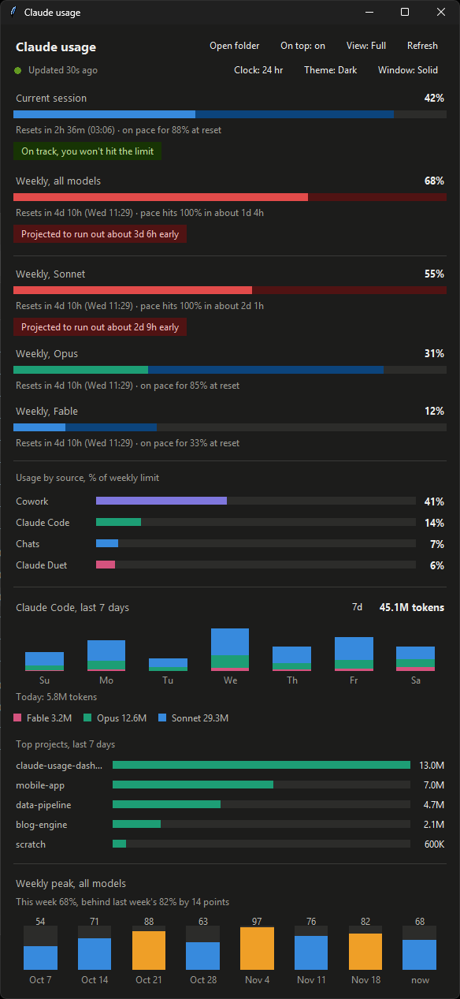
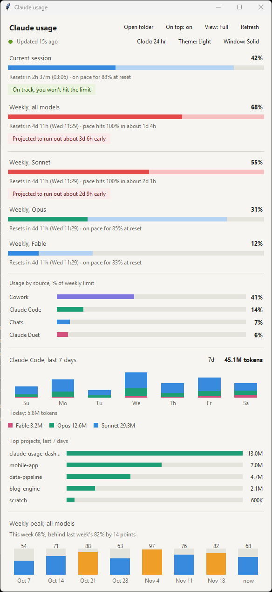

# Claude Usage Dashboard

An always-on-top window (for a second monitor) that shows how much of your Claude plan you've used, when each limit resets, and whether you're on pace to run out. Dark or light, optionally see-through, with a compact view.




Unofficial project. Not affiliated with or endorsed by Anthropic.

## Is this safe?
Yes, and you can check for yourself. It is plain Python source with no compiled program and no hidden installer, and the whole thing is in this repository.
- It runs only on your PC and uses none of your plan. It reads the same usage numbers Claude Code's `/usage` shows, plus Claude Code's local logs.
- Your sign-in goes only to Anthropic, the same place Claude Code sends it. The only other thing it contacts is GitHub, to look for new versions. There are no accounts, ads or analytics.
- App updates only happen when you press **Update now**. `Setup.bat` is a short script you can read first; the only thing it installs is Python (through winget), and only if you don't have it.
- It reads Claude Code's saved sign-in file (`~/.claude/.credentials.json`), which is why this section exists. Details are under [Privacy and safety](#privacy-and-safety).

## Requirements
- Windows, with Python 3.9 or newer and tkinter (the python.org installer includes both). macOS and Linux work too, with a few differences: see [Other systems](#other-systems).
- [Claude Code](https://code.claude.com) installed and signed in once with your claude.ai account (Pro, Max, Team or seat-based Enterprise). The dashboard reads the sign-in Claude Code saves. It does not work with API-key or Console-only logins, or on the Free plan.

## Setup
1. On the [Releases page](https://github.com/tedmelnick/claude-usage-dashboard/releases/latest), download **Source code (zip)** and unzip it somewhere permanent (not inside the zip, and not a temporary folder, because the shortcut points there). Or clone the repo.
2. Double-click `Setup.bat` once. It checks for Python and tkinter (installing Python with winget if missing), checks for Claude Code and its sign-in, and puts a "Claude Usage Dashboard" shortcut on your desktop. If it installs Python, run it a second time afterwards.
3. If Windows shows "Windows protected your PC" for a file from the zip, that is SmartScreen's standard warning for downloaded scripts. Choose **More info**, then **Run anyway**. You can open `Setup.bat` in Notepad first to see exactly what it does.

To remove it, delete the folder and the desktop shortcut. Nothing else is installed (except Python, if Setup.bat installed it).

## Run
Double-click the desktop shortcut or `Start Claude Usage.bat`. Or run `pythonw claude_usage_dashboard.py`.

## What it shows
- **Plan limits**: current session, weekly all models, and a weekly bar for every model your account reports.
- **Reset times**: `Resets in 2h 37m (Sat 12:47 AM)`. A reset later today shows only the time.
- **Projection** under each bar: whether your current pace runs out before the reset, and how early.
- **Usage by source** this week (Cowork, Claude Code, Chats, and so on), when your account reports it.
- **Claude Code history**: tokens by model for the last 7, 14 or 30 days (the `7d` button cycles them), from local logs.
- **Top projects**: which project folders used the most Claude Code tokens in that period.
- **Weekly peak**: the highest all-models percentage reached in each of the last weeks, so you can compare this week with earlier ones. It starts empty and fills in as the app runs.
- **Cost estimate** (optional): totals and per-project dollars once you fill in `prices_per_mtok`. See `prices.example.json`.
- **Version and updates**: the version you're running sits next to the title, with a green check when you're up to date. See [Updates](#updates).
- Buttons: Open folder, On top, Refresh, View (Full / Compact), Theme (dark / light), Window (Solid, See-through, No background), Clock (12 hr / 24 hr).

Updates every 60 seconds. If an update fails, or 5 minutes pass with no success, the status dot turns amber and a banner explains why and when the next try is.

### Compact view
`View: Compact` shrinks the window to the session and weekly bars. A per-model bar appears only when that model is close to or over its limit.

## Alerts
The dashboard sends a desktop notification, and shows a strip at the top of the window (click it to dismiss), when:
- a limit reaches **80%**, **90%** or **100%** (change them with `alert_thresholds`; 100% always alerts),
- you're **on pace to run out** before the reset (`alert_on_runout`),
- a limit you'd used heavily has **reset** (`alert_on_reset`, `alert_reset_min_pct`).

Each alert fires once. The first reading after you start the app is only a baseline, so opening it at 85% doesn't announce 80%. Run `Test alert.bat` to check that notifications reach you. If they don't, Windows Focus Assist / Do Not Disturb may be hiding them; the strip in the window still shows. Set `alerts_enabled` to `false` to turn all of this off, or `alert_sound` to `true` to add the system sound on Windows.

## Updates
The version you're running (for example `v2.3.0`) is shown next to the title, in both the full and compact views.

- A small **green check** after it means you're on the latest release.
- **Click the version** for a menu: **About this app**, **What's new** (the recent changelog entries), **Copy version info** (version, install type, Python and OS, for a bug report), **Open release page** and **Check for updates** (asks GitHub right away).
- When a newer release is published, the check turns into a blue pill such as `↑ v2.4.0`. Click it to read the release notes for every version you're behind.
- Then choose **Update now**, **Later**, or **Skip this version** (**Check for updates** in the version menu brings a skipped update back).
- **Update now** downloads that release from GitHub, replaces the app's files, keeps your `config.json` and `usage_history.db`, and restarts the dashboard. The files it replaced are saved in `_backup_before_update\v<old version>`, and if anything fails they are put back. Nothing is ever installed without you pressing the button.
- The app checks when it starts and every 6 hours. Set `check_for_updates` to `false` to turn that off (**Check for updates** still checks).
- If the folder is a git clone (it has a `.git` folder), the app only tells you about updates; use `git pull` to install them.
- Updates come from published GitHub releases, not from every commit. Pre-releases and drafts are ignored.
- `Preview update.bat` (or `python claude_usage_dashboard.py --demo-update`) shows the pill and the What's new window with made-up releases, and installs nothing.

## Icons and the taskbar
- The desktop shortcut and the window use the icon in `assets/` (a countdown ring around three gauge bars). Run `Setup.bat` again to give an existing shortcut the new icon.
- **Live taskbar icon (Windows):** while the dashboard runs, its taskbar icon is redrawn on each update as two bars, current session on top and weekly (all models) below. A bar is blue normally, amber when it is getting warm (70% used, or on pace to finish above 90%) and red when it is urgent (90% used, or on pace to run out before the reset). An urgent bar also gets a small spark at its tip.
- **Taskbar progress strip (Windows):** the taskbar button also shows a progress strip for whichever of the two limits is more urgent: green, yellow or red to match.
- Turn either off with `dynamic_icon` or `taskbar_progress` set to `false` in `config.json`. Elsewhere the static icon is used.

## Files
- `Setup.bat`: one-time setup (Python check, Claude Code check, desktop shortcut).
- `assets/`: the app icon (`icon.ico`, `icon.png`, and the SVG sources).
- `Preview (demo).bat`: runs with fake data. `python claude_usage_dashboard.py --demo --stale` previews the stale warning.
- `Preview update.bat`: previews the update button with made-up releases.
- `Install hook.bat` (maintainers, once): makes every `git commit` in your clone stamp the release time shown in About, so nothing needs editing by hand.
- `Release.bat` (maintainers): sets the release time shown in About, runs the tests, then commits and pushes. Publishing the release (tag `vX.Y.Z`) is still done on github.com.
- `CHANGELOG.md`: what changed in each version. `LICENSE`: MIT.
- `Debug dump.bat`: writes the raw reply to `dump.json`. Use it if bars are missing or wrong.
- `Test alert.bat`: sends a test notification.
- `config.json`: created on first close. See below.
- `usage_history.db`: the saved limit readings behind the weekly peak chart. Safe to delete; the chart then starts over.
- `_backup_before_update/`: the files the last update replaced. Safe to delete once the new version works.
- `prices.example.json`: example `prices_per_mtok` values.
- `run.sh`: start script for macOS and Linux.
- `usage_dashboard/`: the code. `claude_usage_dashboard.py` just starts it.
- `tests/`: the test suite.

## Settings (`config.json`)
Close the dashboard before editing, because closing it re-saves the settings.

| Setting | Default | Meaning |
|---|---|---|
| `refresh_seconds` | 60 | Seconds between updates |
| `stale_after_seconds` | 300 | When the amber warning appears |
| `user_agent` | `"auto"` | `"auto"` follows the installed Claude Code version. Anything else is sent as written |
| `auto_refresh_token` | `false` | See the note below |
| `history_days` | 7 | 7, 14 or 30 (the `7d` button changes it) |
| `top_projects` | 5 | Projects listed (0 hides the list) |
| `trend_weeks` | 8 | Weeks in the weekly-peak chart (2 to 12) |
| `snapshots_enabled` | `true` | Save readings to `usage_history.db` |
| `snapshot_keep_days` | 365 | Readings older than this are deleted |
| `compact` | `false` | Compact view |
| `dynamic_icon`, `taskbar_progress` | `true` | Live taskbar icon and taskbar progress strip (see Icons and the taskbar) |
| `check_for_updates` | `true` | Look for a newer GitHub release at start and every 6 hours (see Updates) |
| `skipped_version` | `""` | The release you chose Skip this version for |
| `alerts_enabled`, `alert_thresholds`, `alert_on_runout`, `alert_on_reset`, `alert_reset_min_pct`, `alert_sound` | see above | Alerts |
| `prices_per_mtok` | `{}` | Dollars per million tokens by model family, for the cost estimate |
| `open_folder` | your home folder | What the Open folder button opens |
| `theme`, `window_mode`, `glass_alpha`, `clock_24h`, `always_on_top`, `show_zero_sources` | | Look and layout |

## Privacy and safety
- The dashboard talks to Anthropic's own usage endpoint (`api.anthropic.com`), Anthropic's token endpoint if you turn on `auto_refresh_token`, and GitHub (`api.github.com`, `github.com`) to look for and download updates. The GitHub requests carry only the app name and version and no personal data. Turn the automatic check off with `check_for_updates`. Nothing else is sent anywhere.
- Update now downloads the release's source zip from `github.com`, refuses anything that isn't from GitHub or doesn't look like this app, and only ever writes inside the app's own folder. It trusts whatever is in the repository's published releases, the same as downloading one by hand.
- It reads Claude Code's `~/.claude/.credentials.json` and local logs on your PC. Never post that file anywhere.
- `usage_history.db` holds only percentages and reset times. Project names shown in "Top projects" come from your local Claude Code logs and are never sent anywhere.
- To find your Claude Code version for the user agent, it runs `claude --version` on your PC.

### About `auto_refresh_token`
Claude Code's sign-in token expires every few hours. Normally Claude Code renews it the next time you use it, so a dashboard left open overnight shows "Sign-in expired" until then. With `auto_refresh_token` set to `true`, the dashboard renews the token itself so the numbers keep updating.

The catch: renewing rotates the saved refresh token, so the dashboard has to rewrite Claude Code's `.credentials.json`. It re-reads the file first and backs off if Claude Code renewed it in the meantime, and it writes through a temporary file, but it is still a program other than Claude Code changing your sign-in. That's why it's off by default. If Claude Code ever asks you to sign in again, turn it off.

## Notes
- Limits come from an unofficial usage endpoint (the one Claude Code's `/usage` uses). Anthropic can change it without notice. If the format changes, the banner says so, lists the field names the reply now has, and `Debug dump.bat` saves it for inspection.
- If Claude Code's sign-in expires, the banner says so. Open Claude Code once, or turn on `auto_refresh_token` (see above).
- If PowerShell blocks `claude` (scripts disabled), use `claude.cmd` or Command Prompt.
- Projection assumes steady use from the start of the window, so it's an estimate.
- If the usage endpoint answers "rate limited", the dashboard waits longer between tries, up to 15 minutes, and obeys the server's `Retry-After`.

## Other systems
The dashboard is built on Windows, and the macOS and Linux paths have only been tested with the automated tests (which use a stand-in for the window), not on a real desktop. Differences:
- Start it with `./run.sh` (needs Python 3 with tkinter: `brew install python-tk` on macOS, `sudo apt install python3-tk` on Debian/Ubuntu).
- "No background" isn't available (it needs Windows). Solid and See-through are.
- Notifications use `osascript` on macOS and `notify-send` on Linux.
- Fonts fall back to the first of Helvetica Neue, Ubuntu, DejaVu Sans or Helvetica that is installed.
- Claude Code's sign-in on macOS is kept in the Keychain rather than `~/.claude/.credentials.json`, so the dashboard may not find it there.

## Reporting a problem
Click the version next to the title, choose **Copy version info**, and paste it into your report. It has the version, install type, Python and OS, and no file paths or account details. If bars are missing or wrong, run `Debug dump.bat` too, but look through `dump.json` before sharing it.

## Development
```
python -m pip install pytest
python -m pytest
```
The tests cover the parsing and projection maths, history scanning, alerts, backoff, the API error handling, the update check and installer (against a stand-in for GitHub, including a failed install rolling back), and a smoke test that runs the whole window against a stand-in for tkinter. GitHub Actions runs them on Windows and Linux for every push.

## Enjoying it?
If the dashboard is useful to you, please star the repo on GitHub (the Star button at the top right of the page). It is the only way I can tell that anyone is using it, since the app sends no usage data anywhere.

## License
MIT. See `LICENSE`.
